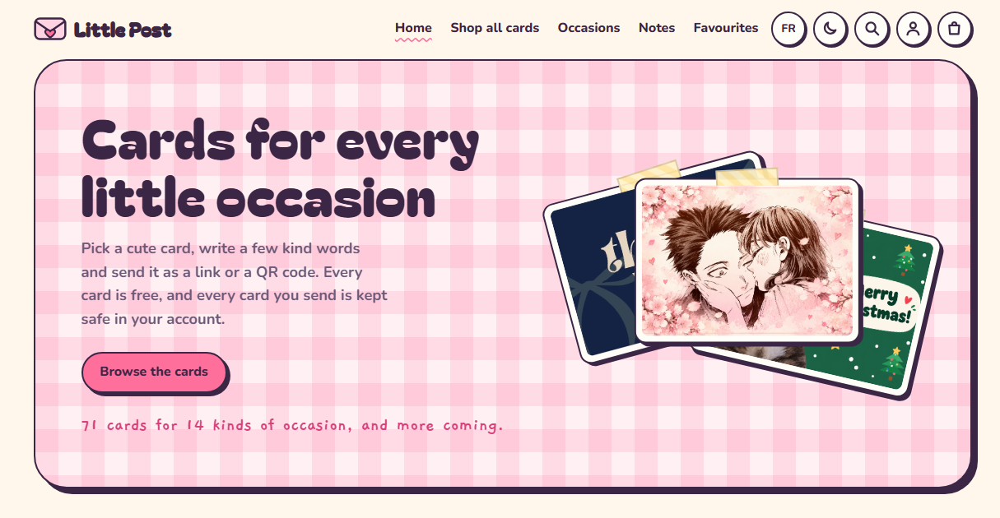
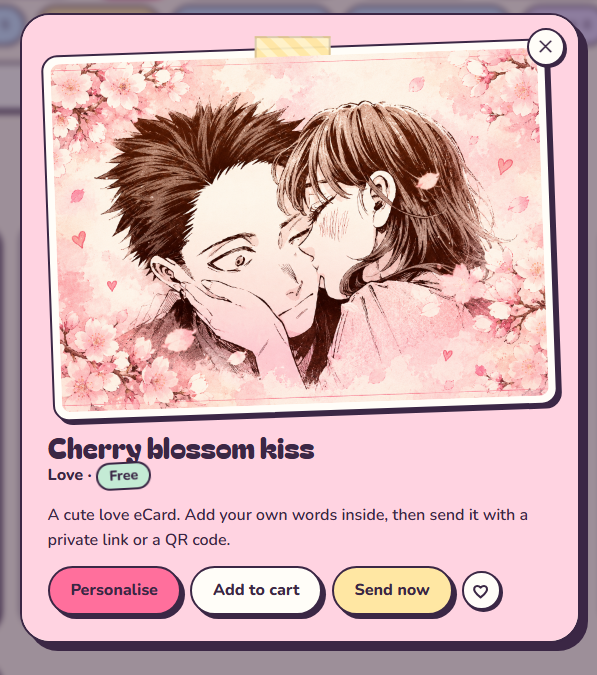
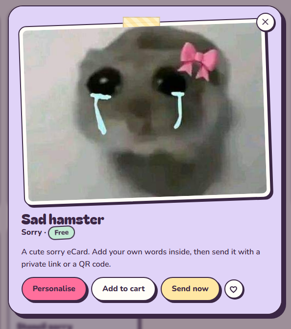

# Little Post 💌

**Cute e-cards for every little occasion, free to send.**

Little Post is a small personal project by Yumi. Pick a card, write a few kind words inside, and send it to someone as a private link or a QR code. When they open it, the card opens like a real one, with your name and message inside.

🌸 **Visit the site:** https://little-post-cards.netlify.app

## What you can do

- **Browse 71 cards** for 14 occasions: birthdays, anniversaries, love, Valentine's Day, Christmas, Halloween, Easter, graduation, Mother's and Father's Day, thank you, thinking of you, congratulations and sorry.
- **Preview any card** before choosing it, then personalise it with the recipient's name, your message (or one of the suggested ideas) and your signature.
- **Send it for free** as a private link or a QR code. Only people with the link can open it.
- **Keep everything in your account:** the cards you've made, your favourites and your saved drafts.
- **Leave a note** on the Notes wall. Notes appear once they've been approved.
- **Switch between English and French**, and between light and dark mode.

	
	

## Made with

- Plain **HTML, CSS and JavaScript**, with no framework and no build step
- **Supabase** for accounts, the database and the Notes wall
- **Netlify** for hosting

---

Made with ♥ by Yumi.
